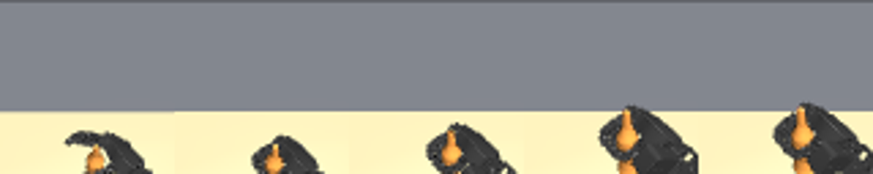

<!-- research-scope-2026-09-12 -->
> **현재 연구와의 관계:** [두 단계 정의](../../../../RESEARCH_PLAN.md)를 기준으로 해석한다.
> 아래는 해당 날짜·설정의 실험 기록이며 수치와 판정은 보존했다. “다음/미실행/진행 중”은 당시 상태다.
> 생성·접근·시각 BC의 개별 결과를 형상 기반 선정/적응 시스템이나 최종 일반화의 증거로 확대하지 않는다.

# Fixed teacher-to-student diagnostic, 2026-09-08

This experiment connects an original Dexonomy grasp to executed synthetic data,
a small visual behavior-cloning student, and simulator evaluation. It is a
**close-and-lift curriculum task with the open hand initialized at the grasp
root pose**. It does not include the approach from home, clutter, a part request,
RL training, or the pretrained DexGraspVLA controller.

## Selection and executor

The candidate is the first candidate in the prior audit manifest, pinned in
[selection.json](selection.json): bottle core_bottle_6444875e3217bf891f5f48a891d827bd,
11_Power_Sphere, scale 0.11, original 0_14_grasp.npy. No pose roll/depth search or
replacement grasp source is used. An exploratory [yaw probe](yaw_probe.log)
tried its five previously feasible yaws. Yaw 0, 30, and 60 degrees lifted above
10 cm; 300 and 330 degrees did not. The recorded task fixes yaw zero. This is
selected task reproduction, not a success estimate over the candidate population.

The full FFW-SH5 scene uses its normal actuators. A one-time initialization
places the open hand at the original teacher root pose with IK. During the
recorded episode all movement is simulated with position actuators; planning
restores the complete integration state after each IK solve. The fingers close
toward the original teacher squeeze target over 90 control ticks. After tick 140,
the root target rises 15 cm over 140 ticks, then holds until tick 350. The
controller operates at 50 Hz. There is no online pose teleportation.

The 350-frame demonstration contains pre-action head RGB plus object mask,
wrist RGB, measured 27-dimensional joint state, commanded 27-dimensional joint
targets, timestamps, and durations. The object mask is nonempty in all frames.
The stored initial state includes controls and solver warm start, not only qpos.
Two stored-action replays start from exactly that state. These deterministic
repeats test reproduction and must not be counted as independent sampled tasks.

## Metrics and interpretation

A diagnostic sustained lift requires rise > 10 cm, at least one annotated
contact group, and no robot-table penetration deeper than 2 mm for 25 consecutive
control ticks (0.5 s). Teacher-compliant lift additionally requires every one
of the five annotated contact-body groups throughout the interval. These are
reported separately. Neither establishes semantic part-contact correctness.

The executor and its two replays give 3/3 diagnostic lifts, about 14.26 cm final
rise, with zero robot-table collision ticks. The longest valid lift lasts 103
control ticks (2.06 s). **Teacher-compliant lift is 0/3**: at most 3/5 required
groups contact. The demonstration is deliberately named diagnostic_demo.zarr;
it is suitable for this interface/memorization test and is **not a clean positive
example for the proposed contact-preserving knowledge-transfer claim**.

## Student and evaluation

The small recurrent student area-pools the two camera inputs to 8x8 pixels,
encodes their seven channels with a 96-unit layer, concatenates normalized joint
state, and runs a 128-unit GRU and 27-output head. No object pose, teacher target,
contact labels, explicit phase, time, IK call, or stored expert action is supplied
during student execution. The recurrent state can nevertheless encode elapsed
time; this single-trajectory experiment cannot establish visual feedback skill.
This is a torch-only baseline, not the diffusion/vision-language architecture or
pretrained weights of DexGraspVLA. It has no language/part grounding.

Training uses the single full demonstration, seed zero, Adam at 0.001 for 1500
updates, with action normalization and gradient clipping. There is no held-out
validation set. Training action RMSE is about 0.000879 rad. Closed-loop results
and the zero-image diagnostic are recorded separately in evaluation JSON files.
The completed runs give:

| Execution | Sustained lift | All teacher groups preserved | Final rise |
|---|---:|---:|---:|
| IK expert + stored-action replays | 3/3 | 0/3 | 14.26 cm |
| Visual BC, fresh identical-state resets | 3/3 | 0/3 | 14.23 cm |
| Same BC with zeroed image inputs | 0/1 | 0/1 | 0.028 cm |

Student lifts last 105 consecutive control ticks (2.10 s), with zero measured
robot-table collision ticks. These counts are deterministic repetitions of one
selected state, not independent success-rate estimates.
See [collection](collection.json), [student evaluation](evaluation.json),
[blank-image evaluation](blank_images.json), [training loss](loss.tsv), and
[compiled physical settings](physics.json). The compiled object mass is
0.09528843 kg; nominal mass is 0.1 kg.

Blanking images at evaluation is an out-of-distribution sensitivity diagnostic,
not a matched state-only training ablation or evidence of useful visual grounding.

## Reproduce

Run from the project root, with the existing Dexonomy interpreter (MuJoCo 3.3.3,
Torch 2.6.0+cu124, CPU training; EGL rendering). Use fresh output directories:

~~~bash
OPENBLAS_NUM_THREADS=1 third_party/dexonomy/.venv/bin/python scripts/fixed_student_experiment.py collect \
  --manifest results/2026-09-08/fixed-student/selection.json --out out/fixed-repro-data
OPENBLAS_NUM_THREADS=1 third_party/dexonomy/.venv/bin/python scripts/fixed_student_experiment.py train \
  --data out/fixed-repro-data --out out/fixed-repro-train --steps 1500 --seed 0
OPENBLAS_NUM_THREADS=1 third_party/dexonomy/.venv/bin/python scripts/fixed_student_experiment.py evaluate \
  --checkpoint out/fixed-repro-train/student.pt --out out/fixed-repro-eval --episodes 3
OPENBLAS_NUM_THREADS=1 third_party/dexonomy/.venv/bin/python scripts/fixed_student_experiment.py evaluate \
  --checkpoint out/fixed-repro-train/student.pt --out out/fixed-repro-blank --episodes 1 --blank-images
~~~

The retained run uses out/fixed-student-v2, out/fixed-student-train-v2,
out/fixed-student-eval-v2, and out/fixed-student-blank-v2. Model, NPZ, Zarr, full
integration state, and trace arrays remain under ignored out/. Small manifests,
loss, evaluation summaries, and images are copied here for review. v1 is a local
prototype predating formatting changes; v2 was recollected with the final script.
Code, scene, source-candidate hash, and simulator version are checked, but external
mesh and robot assets are not bundled. Exact reproduction requires those assets
to remain unchanged at the recorded paths; this is not a portable benchmark.

## What this changes

The small synthetic-data-to-student connection now works for initialized
close/lift. A long PPO run is not needed to test this particular connection.
This does not show that IK solves full approach or that RL cannot help it.
The observed missing teacher contacts remain a concrete transfer failure. Next
compare execution on the same candidate while preserving all required contacts,
and extend the reset backward along an explicit collision-checked approach.
Only then collect clean positives, adapt the intended student, and test held-out
objects/part requests with matched teacher ablations. Keep the current diagnostic
separate so its physical lifts cannot be reported as contact-preserving success.

Validation: 38 repository tests passed, including spatial camera/mask pooling,
sustained-vs-contact-compliant metrics, and complete simulator-state replay.
Scoped Ruff and git diff --check passed. No LaTeX engine was installed; the
updated paper received static structural checks only.

Follow-up: [contact and full-approach validation](../contact-approach/README.md)
now reproduces home-to-lift on this candidate by screening the approach direction.
It still fails all-group compliance. The student results above remain the
original initialized-at-grasp experiment, without full-approach retraining.
