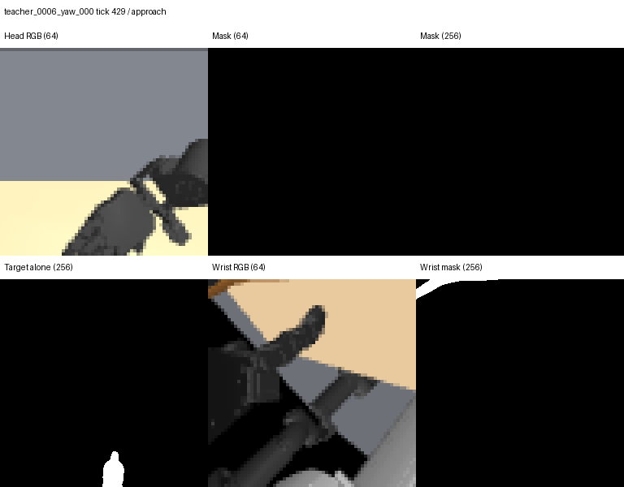

<!-- research-scope-2026-09-12 -->
> **현재 연구와의 관계:** [두 단계 정의](../../../../RESEARCH_PLAN.md)를 기준으로 해석한다.
> 아래는 해당 날짜·설정의 실험 기록이며 수치와 판정은 보존했다. “다음/미실행/진행 중”은 당시 상태다.
> 생성·접근·시각 BC의 개별 결과를 형상 기반 선정/적응 시스템이나 최종 일반화의 증거로 확대하지 않는다.

# 목표 mask 소실 원인 진단 — 2026-09-09

**진단 완료. 검사한 데이터의 mask 생성 오류는 발견하지 못했다.** 로봇 손에 의한
가림, 화면 아래쪽의 잘림, 64×64의 픽셀 샘플링이 함께 영향을 준다. MuJoCo의
segmentation으로 현재 보이는 물체 mask는 얻을 수 있지만, 가려진 목표를 기억하는
정책까지 자동으로 생기는 것은 아니다. 학습은 실행하지 않았다.

## 재현과 원인 분리

대상은 `out/offset-compare-93/executed-offset`의 승인 시범 9개, 8,817프레임이다.
물체는 같은 DGN 병 하나, grasp type은 Inferior Pincer다. 각 시범의 해시가 검증된
compiled MJB와 전체 초기 integration state를 복원하고, 저장된 float64 actuator 명령을
그대로 재생했다. MuJoCo 3.3.3, EGL, 제어 간격 0.02초, physics 10 substeps를 유지했다.

- **전 프레임의 저장 관절 상태·timestamp·head mask가 재현본과 정확히 일치했다.**
  비교 관절 상태는 저장 형식인 float32다. RGB 전체의 비트 일치를 주장하지 않는다.
- 빈 head mask는 **4개 시범의 1,090프레임(12.36%)**이다.
- 실제 장면의 segmentation과 대상 물체만 남긴 진단 렌더를 대조했다. 비대상 geom의
  시각 그룹만 잠시 숨긴 뒤 즉시 복원했고, 각 진단에서 integration state 불변을 검사했다.
- 비대상 물체를 숨기면 빈 프레임 **전부에서** 병이 나타났다. 64×64에서도 최소 52픽셀,
  256×256에서는 860–2,141픽셀이다. 따라서 병이 통째로 시야 밖에 있거나, 병 전체가
  원래부터 1픽셀보다 작거나, 잘못된 geom ID를 선택해서 발생한 소실로 설명되지 않는다.
- 가려진 병 실루엣 위치를 실제 장면의 body ID와 대조하면 주로 `hx5_r_base`와
  `finger_r_link*`가 앞에 있다. 일부 구간은 `arm_r_link7`이다.

현재 추출 코드는 MuJoCo segmentation의 **(object ID, object type)** 쌍에서 대상
subtree의 geom ID와 `mjOBJ_GEOM`을 함께 선택한다. 설치된 MuJoCo 3.3.3
`renderer.py`의 변환과 대조했다. 관련 API는 [공식 Python 문서](https://mujoco.readthedocs.io/en/3.3.3/python.html)를 참고한다.

## 해상도·카메라 비교

아래 분모는 모두 **원래 head 64×64 mask가 비었던 1,090프레임**이다. 다른 프레임에서
새 설정이 만드는 소실은 전수 측정하지 않았으므로, 전체 데이터의 개선율로 바꾸어
읽으면 안 된다. 복구는 최소 1픽셀이 보인다는 뜻이며, 목표 인식/파지 성공이 아니다.
해상도는 저장 영상을 확대하지 않고 같은 물리 상태에서 새로 렌더링했다.

| 조건 | 목표가 다시 보이는 프레임 | 10픽셀 이상 | 보이는 경우의 픽셀 수 중앙값 |
|---|---:|---:|---:|
| 기존 head, 256×256 | 241 | 16 | 4 |
| 기존 head, 448×448 | 250 | 71 | 9 |
| head 아래로 20° 회전, 256×256 | 505 | 317 | 50 |
| head 수직 시야각 60°→90°, 256×256 | 467 | 283 | 28 |
| 기존 wrist, 64×64 | 691 | 684 | 137 |
| 기존 wrist, 256×256 | 693 | 692 | 2,164 |

기존 head의 256 해상도에서 여전히 비어 있는 **849프레임**은 같은 해상도의
물체 단독 렌더에서는 보인다. 해상도에 민감하게 복구된 241프레임도 대부분 소수의
경계 픽셀뿐이다. 448까지 올려도 비어 있던 프레임 복구는 9개만 추가된다.

시야에서 **일부가 잘리는 문제**는 별도로 있다. 물체 단독 256 렌더의 실루엣이
1,062/1,090프레임에서 영상 경계에 걸린다. 아래로 20° 회전하면 경계에 걸리는
프레임이 0이 된다. 이 비교는 카메라의 광학 중심을 옮기지 않고 방향만 바꾼 것이다.
원래 시야 안의 가림을 투시한 것이 아니라 잘려 있던 영역을 추가로 관측한다.
시야각을 넓히는 것보다 아래로 향하는 설정이 이 표본에서는 더 많은 픽셀을 확보했다.

기존 head와 wrist를 모두 256으로 쓰면 둘 중 하나에서 보이는 프레임은 **754/1,090**,
아래로 20° 향한 head와 기존 wrist의 조합은 **848/1,090**이다. 후자도 이 부분집합에서
**242프레임은 두 카메라 모두 mask가 0**이다. 카메라만으로 소실이 해결됐다고 볼 수 없다.

| 시범 | 원래 빈 head mask | 기존 head 256에서 보임 | wrist 256에서 보임 | 아래로 20° head에서 보임 |
|---|---:|---:|---:|---:|
| `teacher_0006_yaw_000` | 565 | 149 | 276 | 408 |
| `teacher_0008_yaw_000` | 80 | 6 | 17 | 8 |
| `teacher_0009_yaw_000` | 12 | 11 | 0 | 12 |
| `teacher_0016_yaw_000` | 433 | 75 | 400 | 77 |

가장 긴 기존 head 소실 구간은 524 tick, **10.48초**다. 원래 빈 프레임 중 기존
head·wrist를 256으로 확인해도 둘 다 비어 있는 연속 구간이 237 tick, **4.74초** 있다.
짧은 관측 이력이나 직전 mask 복사만으로 목표 유지를 보장할 수 없다.



왼쪽 아래 `Target alone`은 진단용 렌더다. 실제 카메라 입력으로 대체하지 않는다.
[손목 카메라에서 목표가 보이는 다른 시점](wrist-visible.png)도 함께 보존했다.

## 결정과 후속 구현

1. **기존 visible-mask 생성 방식은 유지한다.** 빈 mask는 현재 가시성이 없다는 관측으로
   보존한다. 물체 단독 실루엣이나 이전 시점 mask로 현재 정답을 덮어쓰지 않는다.
2. **다음 작은 수집의 설정 후보는 native 256×256와 head 하향 구도다.** 실제 카메라의
   장착/보정값과 비교하고, 다른 물체·배치의 전체 궤적에서 잘림과 두 카메라 가시성을
   검증한 뒤 공통 설정으로 확정한다. 여기서 전역 카메라 설정을 바꾸지는 않았다.
3. **wrist의 목표/부위 mask를 head와 별도로 연결한다.** 지금 저장 스키마는 wrist RGB만
   제공한다. wrist RGB가 이미 모델에 들어간다는 사실과 wrist의 목표 지시가 전달된다는
   것은 다르다. 현재 실제 부위 mask의 효과는 이 물체 전체 mask 검사로 검증되지 않았다.
4. **현재 mask와 별도로 지속되는 목표 기준 관측을 구현한다.** 요청 시 보이는 목표의
   RGB crop·물체/부위 mask를 보존해 현재 관측과 함께 조건화한다. 새 요청 때 교체하고,
   소실 중에도 요청 의미를 유지한다. 미래 영상이나 teacher/world pose는 기억 입력으로
   쓰지 않는다. 현재 한 장 입력 모델에는 이 기능이 아직 없다.

이 내용은 [student 입력 계약](../../../../docs/target-contract.md)에 반영했다.
다음 완료 조건은 같은 장면에서 서로 다른 두 목표가 모두 가려져도 조건이 구별되고,
가려짐 후 폐루프 실행에서 지정한 물체/부위를 유지하는 것이다. mask의 비어 있지 않음은
이 완료 조건을 대신하지 않는다.

## 재실행과 검증

진단 도구는 `scripts/audit_mask_visibility.py`다. 출력 디렉터리는 새 경로여야 한다.

```bash
MUJOCO_GL=egl OPENBLAS_NUM_THREADS=1 OMP_NUM_THREADS=1 \
third_party/dexonomy/.venv/bin/python scripts/audit_mask_visibility.py \
  --dataset out/offset-compare-93/executed-offset \
  --out out/mask-visibility-20260909

MUJOCO_GL=egl OPENBLAS_NUM_THREADS=1 OMP_NUM_THREADS=1 \
third_party/dexonomy/.venv/bin/python scripts/audit_mask_visibility.py \
  --dataset out/offset-compare-93/executed-offset \
  --out out/mask-camera-checks-20260909 --camera-checks \
  --episode teacher_0006_yaw_000 --episode teacher_0008_yaw_000 \
  --episode teacher_0009_yaw_000 --episode teacher_0016_yaw_000
```

첫 실행은 전 8,817프레임, 두 번째는 해당 4개 시범의 전 3,905프레임에서 관절 상태·
timestamp·원본 mask 재현을 확인했다. 고해상도/카메라 비교는 빈 프레임 전부와 각
연속 구간 시작·중간·끝 및 초기 양성 대조 프레임에 수행했다. 시각화 전용 변경 후
model geom group·camera 설정과 integration state 복원도 확인했다.

새 진단 회귀 테스트 3개와 기존 conditioning 테스트 6개 **총 9개 통과**.
가림 제거로 대상이 나타남, 시야 밖 물체를 만들어내지 않음, 물리 상태·카메라·시각 그룹
복원, geom type/ID 구분을 검사했다. CPU OSMesa로 합성 장면 테스트를 실행했고,
원본과 픽셀 단위 대조하는 실제 시범 검사는 원래와 같은 GPU EGL을 사용했다.
CPU 렌더러는 초기 대조에서 경계 픽셀 차이가 있어 원본 일치 판정에 쓰지 않았다.
Ruff는 새 코드 두 파일에서 통과했다. 기존 실행기/제어기/데이터는 변경하지 않았다.

집계는 [metrics.json](metrics.json), [전체 재현 요약](replay-summary.json),
[카메라 비교 요약](camera-summary.json)에 있다. 각 프레임의 수치와 body ID 귀속은
두 `out/` 경로의 `frames.jsonl`에 보존했고 해시는 `metrics.json`에 기록했다.

**한계:** 동일 병·동일 grasp type의 9개 시범이다. 다른 물체, 의미 부위 mask, 실제
카메라, 추정 segmentation, 시각 정책 학습 성공으로 일반화하지 않는다.
