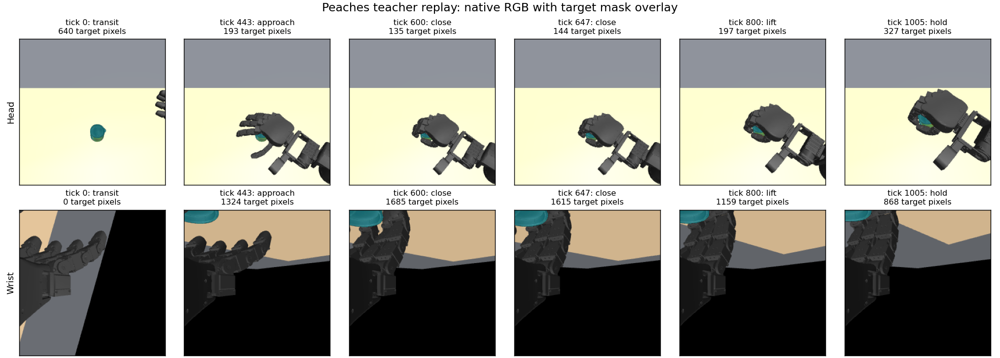

<!-- research-scope-2026-09-12 -->
> **현재 연구와의 관계:** [두 단계 정의](../../../../RESEARCH_PLAN.md)를 기준으로 해석한다.
> 아래는 해당 날짜·설정의 실험 기록이며 수치와 판정은 보존했다. “다음/미실행/진행 중”은 당시 상태다.
> 생성·접근·시각 BC의 개별 결과를 형상 기반 선정/적응 시스템이나 최종 일반화의 증거로 확대하지 않는다.

# HOPE 시범의 시각 student 인수

2026-09-11, 진행 중. Teacher 생성·제어·성공 한계와 실행 중인 x0 학습/평가 계약은
변경하지 않았다. 이 문서는 **학습 입력 준비**이며 학습된 정책의 파지 결과가 아니다.

## 중앙 조건

| 항목 | AlphabetSoup | Peaches |
| --- | --- | --- |
| Teacher 동적 완주 | 1/12 | 1/12 |
| 같은 후보 controller 재실행 | episode SHA 동일 | episode SHA 동일 |
| 변환 tick | 1,192 | 1,006 |
| 원본 대비 측정 상태 불일치 / 최대 물리 신호 차이 | 0 / 0.0 | 0 / 0.0 |
| 머리 카메라 목표 mask 빈 tick | 749 | 0 |
| 두 카메라 목표 mask 모두 빈 tick | 33 | 0 |
| 인과적 목표 참조 획득 tick(머리/손목) | 0 / 387 | 0 / 443 |
| 기존 student 기록 명령 대조군 | tick 621 이동 제한 위반 | 완주 |
| 데이터 인수 | 보류 | 통과 |

AlphabetSoup의 보류 원인은 [획득 판정 계약 차이](../student-acquisition-contract/README.md)다.
시각 변환이나 물리 재현이 달라진 것이 아니다. Teacher가 닫기 중 허용하는 이동이,
현재 student 평가에서는 충분한 접촉이 연속 유지되기 전의 접근 이동으로 판정된다.
한계를 완화하거나 teacher의 단계 라벨을 정책 입력에 넣지 않았다.

Peaches 기록 명령 대조군은 14.81 cm까지 상승했고, 종료 시 5/5 접촉군을 유지했다.
연속 2.78초 동안 높이·요구 접촉 조건을 만족했다. 정지 대조군은 상승 0·접촉 0이다.
최대 침투 1.961 mm, 최대 손가락 힘 28.89 N으로 현재 한계 안이지만 여유가 작다.
같은 조건 재현과 이 검사는 물리 조건 변화나 실물 환경에 대한 견고성 증명이 아니다.

온라인/오프라인 목표 기억은 전체 tick 순서로 확인했다. 실제 전처리 텐서 일치는
Peaches의 tick 0/200/443/450/1005에서 확인했으며, 모든 tick의 DINO 추론을
수행했다는 뜻은 아니다. 아래는 저장된 native 256×256 RGB와 simulator 목표 mask다.
청록색 반투명 표시만 추가했고, teacher 단계는 그림 설명에만 사용했다.

## lecun 연결

Peaches의 데이터·모델·초기 상태·변환 소스 14파일, 235,326,449바이트를 복사했고
모든 파일의 SHA256과 크기가 일치했다. 데이터 위치는
`/data1/yspark/projects/dexprompt/student-data/hope-pilot-v1/Peaches`다.
`dexprompt-hope-peaches-check`가 원격 cache/preflight/기록 명령·정지 대조군을
검사했다. 실제 DINO forward 검사는 x0 평가와 후속 진단이 끝난 뒤 수행하도록 대기 중이다.
Backward와 optimizer 갱신은 호출 시 오류가 나게 막았으며, 새 학습은 없다.

## 추가 배치와 분모

`watch_hope_placement_intake.py`는 이미 계획된 yaw ±15°, X ±20 mm 조건만 기다린다.
첫 accepted episode와 그 후보의 동일 controller 재현을 묶어 검사하고, 현 student
계약에 맞는 자료만 전체 변환·cache·입력 감사·대조군·preflight로 넘긴다.
원본 신호의 사전 검사 통과만으로 데이터 ready를 선언하지 않는다.

`report_hope_student_pool.py`가 같은 재현 시범의 중복 계수를 거부하고, 물체·정확한
mesh 파일·물체별 배치·teacher 후보·파지 유형·실제 초기 정책 입력을 각각 센다.
현재 snapshot `out/hope-student-pool-0455.json`은 Peaches 1건/1,006프레임이다.
모든 HOPE 파일럿 자료는 개발용이며, 임의 frame 분할을 독립 test로 사용하지 않는다.
서로 다른 상품명이나 mesh 해시만으로 형상 독립성을 주장하지 않는다.

## 원시 근거

- 중앙 인수: `out/hope-student-intake-v2/results.json`과 각 물체별 render/audit/controls/preflight.
- 재현 귀속: `out/hope-student-readiness-0421.json`.
- 원격 전송: `out/hope-peaches-transfer-v1.json`; lecun의 `Peaches-transfer-receipt.json`.
- 추가 배치: `out/hope-placement-intake-v1/`.
- 인수 감시·재현 귀속 검사 17개, 다양성 계수 검사 2개 통과. 전체 저장소 검사 결과와 구분한다.
