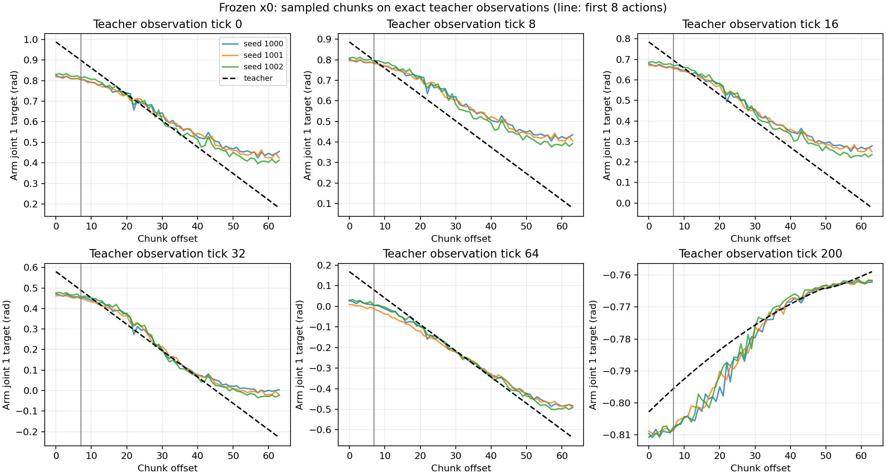

<!-- research-scope-2026-09-12 -->
> **현재 연구와의 관계:** [두 단계 정의](../../../../RESEARCH_PLAN.md)를 기준으로 해석한다.
> 아래는 해당 날짜·설정의 실험 기록이며 수치와 판정은 보존했다. “다음/미실행/진행 중”은 당시 상태다.
> 생성·접근·시각 BC의 개별 결과를 형상 기반 선정/적응 시스템이나 최종 일반화의 증거로 확대하지 않는다.

# Teacher 관측에서의 행동 생성 진단 — 완료

기록된 teacher 관측에서도 초기 팔 행동 생성 오차가 재현된다. 실행 중 관측이 시범에서
벗어나는 현상만으로는 기존 실패를 설명할 수 없다. 이번 검사에서 라벨 인덱스나
학습 데이터와 online 전처리의 불일치는 발견하지 못했다. 새 학습·물리 실행은 없다.

## 고정 조건과 검증

실행 전 [plan.json](plan.json)을 고정했다. 단일 병 x0 최종 checkpoint
`epoch_0012.pt`(SHA256 `a5100b38f9c1fb64…`)의 8시점×3seed=24행동묶음,
horizon64/inference16. 모델·정규화·DINO·관측·샘플러·성공 기준은 변경하지 않았고
변화량 제한기는 사용하지 않았다. lecun GPU1의 tmux에서 약64초, 종료 코드0으로 끝났다.

- 8시점 모두 전체 과거 기록을 순서대로 읽은 GoalMemory online 전처리와
  EpisodeChunks 입력 텐서가 정확히 같다. 미래 reference는 사용하지 않았다.
- 행동 라벨은 원본의 `action[t:t+64]`와 일치한다. 선택한 시점은 끝부분 패딩이 없다.
- 기존 4시점×3seed 진단과 겹치는 첫 행동 오차12개가 정확히 재현됐다(차이0).
- 모델 상태 전체 해시와 checkpoint 파일 해시가 전후 동일하다. backward와 optimizer
  갱신은 호출하면 예외를 내도록 막았다.
- 시점마다 seed1000/1001/1002를 초기화했다. 폐루프에서 진행되는 RNG와 같다는 뜻은 아니다.
  phase와 최근접 teacher 행동 index는 분석에만 쓰며 모델 입력이 아니다.

## 오차가 발생하는 구간

첫 행동 최대 오차는 27관절 중 최대 절댓값의 seed 범위다. 팔8행동 RMSE는
첫8개 행동×팔7관절에 대한 값의 seed 중앙값이다. 모두 rad 단위다.

| teacher tick | 단계 | 첫 행동 최대 오차 | 팔8행동 RMSE | 이전 명령 유지의 팔8행동 RMSE |
| --- | --- | --- | --- | --- |
| 0 | transit | 0.158–0.170 | 0.0644 | 0.0292 |
| 8 | transit | 0.079–0.091 | 0.0268 | 0.0318 |
| 16 | transit | 0.099–0.115 | 0.0361 | 0.0319 |
| 32 | transit | 0.104–0.118 | 0.0361 | 0.0319 |
| 64 | transit | 0.138–0.160 | 0.0520 | 0.0318 |
| 200 | descend | 0.068–0.070 | 0.0386 | 0.0118 |
| 450 | arrive | 0.0026–0.0031 | 0.00119 | 0.00045 |
| 700 | lift | 0.0460–0.0464 | 0.0270 | 0.00519 |

이전 명령 유지는 통계 비교일 뿐 실행 정책이 아니다(tick0만 현재 측정 관절값).
정지하면 파지할 수 없으므로 이 표로 정지 정책이 더 좋다고 결론내리지 않는다.

초기5시점의 최대 오차 관절은 팔 관절1이다. 초기 손8행동 RMSE는
0.00016–0.00048 rad로 훨씬 작다. 손이 열린 채 거의 움직이지 않는 구간이므로
이를 손가락 제어 학습의 성공으로 해석하지 않는다.

초기 구간은 예측 시작점이 teacher의 나중 명령 쪽으로 앞서지만, 묶음 끝에서는
오히려 뒤처진다. 예를 들어 tick0/seed1000의 관절1 오차는 offset0에서 −0.1628,
offset63에서 +0.2744 rad다. 단순한 고정 시간 이동만으로 설명되는 모양은 아니다.
첫 팔 명령의 최근접 teacher index는 초기5시점에서 현재보다6–13tick 뒤지만,
이 값은 실제 진행도를 뜻하지 않는다. 반복 자세가 있는 tick450에서는
최근접 index가456 또는627로 갈린다.

## 결론과 한계

동일한 시범 관측을 받아도 팔 행동묶음이 정확하지 않으며, 특히 움직임이 큰 초기
구간에서 차이가 크다. 이전 slew 제한은 이 차이의 실행 영향을 줄였지만 완주는0/3이었다.
이번 결과로 시각 특징, 학습 손실, 모델 적합 부족, 샘플링 과정 중 어느 것이 원인인지
구분되지는 않는다. 모델/라벨/제어를 수정할 검증된 오류는 아직 발견하지 못했다.
teacher 관측에서의 오차가 줄더라도 폐루프 성공을 별도로 확인해야 한다.

## 당시 다음 단일 요인 실험 — 이후 완료

아래 계획은 이후 사용자 승인으로 실행했다.
[추론16 대50 결과](../student-sampler-steps/README.md): 첫8팔행동 오차24/24 악화, 기존16 유지.

같은 checkpoint·8관측·3seed에서 **inference_steps16→50만** 바꿔 비교한다.
기존24개를 A로 재사용하고 B24개만 생성한다. 학습 때의 diffusion 단계50을 모두
사용했을 때 생략된 샘플링 단계의 영향이 줄어드는지 확인하는 검사다.
모델 구조·학습·손실·limiter·물리·데이터는 바꾸지 않으며 단계 수 탐색도 하지 않는다.
첫1/8/64행동의 팔·손 오차를 모든 시점에서 짝지어 보고한다. 좋은 시점만 선택하지 않는다.
이 결과를 보기 전 새 HOPE 학습이나 대규모 재학습은 시작하지 않는다.

## 재현 자료

- [원시 진단](raw/diagnosis.json), `raw/frame_XXXX_seed_XXXX.npz` 24개,
  [요약](analysis/summary.json), [종료 코드](exit-code).
- 실행기 `scripts/diagnose_teacher_observations.py`, 보고 도구
  `scripts/summarize_teacher_observations.py`. 새 진단 회귀 테스트2개 통과, 변경 파일 Ruff 통과.
- 원격 결과 `/data1/yspark/projects/dexprompt/student-checks/teacher-observations-v1`;
  같은 부모의 `teacher-observations-job-v1`에 실행 로그와 종료 기록이 있다.
- 기존 fixed7과 새5는 별도 보관(합계12시범/12,477프레임). Claude의 teacher 물리 비교,
  모델·데이터·기존 checkpoint를 변경하지 않았다.
