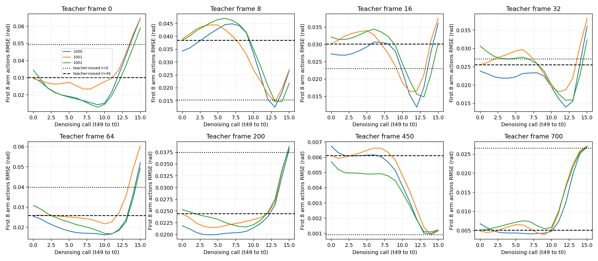

<!-- research-scope-2026-09-12 -->
> **현재 연구와의 관계:** [두 단계 정의](../../../../RESEARCH_PLAN.md)를 기준으로 해석한다.
> 아래는 해당 날짜·설정의 실험 기록이며 수치와 판정은 보존했다. “다음/미실행/진행 중”은 당시 상태다.
> 생성·접근·시각 BC의 개별 결과를 형상 기반 선정/적응 시스템이나 최종 일반화의 증거로 확대하지 않는다.

# x0 단일 단계 예측과 생성 경로 — 완료

**이 checkpoint의 오차는 낮은 잡음 단계의 x0 추정에서도 나타나며, 실제 생성 경로의
마지막 단계에서 첫8개 팔 행동 오차가24/24 증가한다.** 샘플링 단계 수만 늘리는 처방을
뒷받침하지 않는다. 다만 학습 손실·모델 적합·조건 사용 중 어느 것이 원인인지는 미확정이다.
새 학습·물리 실행·모델 수정은 하지 않았다.

## 고정 조건과 계측 검증

사용자 승인 후 [계획](plan.json)을 고정했다. 이전과 같은 단일 병 x0 최종 checkpoint
`epoch_0012.pt`(SHA `a5100b38f9c1fb64…`), teacher 관측8시점,
seed1000/1001/1002. DINO·정규화·입력·50개 학습 diffusion 단계·16개 추론 단계 그대로다.

- 정답 행동을 정규화해 같은 seed의 Gaussian 잡음을 넣고 t=0/25/49에서 직접 x0를
  예측했다: **72개 단일 단계 예측**. t별 alpha_bar는0.9982525/0.4627069/0.0000009712.
  정답 정보를 넣는 진단이며 배포 가능한 정책 성능으로 세지 않는다.
- 실제 `predict_action()`에 반환값을 바꾸지 않는 hook을 붙였다: **24개 생성 경로,
  경로당16회 예측**. raw x0·입력 noisy action·clipped 행동 오차를 저장했다.
- 생성의 최초 noise는 직접 예측에서 사용한 noise와 정확히 같다. 관측 해시·라벨도
  기존 진단과 일치하며, **최종24개 행동묶음 모두 기존16단계 출력과 정확히 같다**.
- 모델 전후 전체 상태 해시가 같고 checkpoint 파일도 불변. backward/optimizer는
  호출하면 예외로 차단했다. lecun GPU1 tmux에서67.2초·exit0, 작업 종료 확인.

## 결과: 첫8개 팔 행동 오차

단위rad, 첫8행동×팔7관절 RMSE의3seed 중앙값이다. 생성 경로 열은 각 시점의
네트워크 x0 추정치를 행동 단위로 환산한 오차이며 noisy latent 자체의 오차가 아니다.

| 관측tick | 정답+잡음 t0 | 정답+잡음 t25 | 정답+잡음 t49 | 순수잡음 생성 첫 추정 t49 | 생성 최종 t0 |
| --- | --- | --- | --- | --- | --- |
| 0 | 0.04934 | 0.01539 | 0.03004 | 0.03007 | 0.06439 |
| 8 | 0.01534 | 0.04309 | 0.03847 | 0.03845 | 0.02677 |
| 16 | 0.02308 | 0.02991 | 0.03017 | 0.03016 | 0.03611 |
| 32 | 0.02712 | 0.02610 | 0.02556 | 0.02555 | 0.03609 |
| 64 | 0.03985 | 0.01939 | 0.02587 | 0.02587 | 0.05203 |
| 200 | 0.03747 | 0.02161 | 0.02442 | 0.02443 | 0.03859 |
| 450 | 0.00092 | 0.00600 | 0.00611 | 0.00612 | 0.00119 |
| 700 | 0.02658 | 0.00525 | 0.00513 | 0.00513 | 0.02696 |

1. **생성 마지막 호출(t3→t0)에서24/24 오차가 증가한다.** 최초 추정과 최종 추정의
   비교에서는17/24 증가,7/24 감소다. 중간에 줄었다가 마지막에 커지는 경우가 있으므로
   “생성 과정 내내 악화”라고 말하지 않는다. 도착 구간tick450은 최종 절대 오차가 작다.
2. **낮은 잡음의 정답 입력에서도 오류가 남는다.** 저장된 정규화와 실제 사용 noise로
   t0 입력을 재구성했다. 입력 자체의 팔8행동 오차 중앙값은 각 관측에서약0.0229rad인데,
   출력은tick0에서0.0493, tick64에서0.0398rad다.24쌍 중17쌍은 출력이 입력보다
   틀리고7쌍은 개선된다. 모든 관측에서 잡음 제거에 실패한다는 뜻은 아니다.
   [입력 기준선](analysis/noisy-input-baseline.json)은 모델 추가 실행 없이 계산했다.
3. **t49 정답+잡음과 순수잡음 첫 추정은 가깝다.** 이 단계는 alpha_bar가 매우 작아
   정답 신호가 거의 사라진 조건이다. 두 결과의 유사성은 시각 grounding의 증거가 아니다.
4. **clipping만으로 설명되지는 않는다.** tick200·700은 전체 생성 경로에서 팔의
   clipping 비율이0인데 최종 오차가 증가한다. 반대로tick450에서는 최대57.1%까지
   clipping되지만 팔8행동 최종 오차는0.00119rad다. 이 비율은 정규화 범위 밖의
   추정값이며 물리 관절 한계나 침투가 아니다. clipping 제거 실험은 하지 않았다.

## 판단과 다음 작업

이 모델은 정답에 가까운 낮은 잡음 입력에서도 일부 움직임 구간의 팔 행동을 정확히
복원하지 못한다. 순수잡음 초기화나16단계 생략만으로 현재 오류를 설명할 수 없다.
단일 단계 추정 오차와 생성 후반 악화가 함께 관측됐지만, 학습 목적의 가중치·모델
적합 부족·조건 사용·생성 입력 분포의 영향을 이 검사만으로 구분할 수는 없다.

**중간에 가장 잘 맞는 단계를 골라 조기 종료하는 정책으로 바꾸지 않는다.** 위 곡선은
정답을 보고 계산한 진단이고, 좋은 단계는 관측마다 다를 수 있다. 학습 관측8개에 맞춰
추론 규칙을 선택하면 별도 검증이 필요하다. 기존16단계 모델과 데이터는 보존한다.

다음 재학습을 설계한다면 낮은 잡음 단계와 행동묶음 앞부분의 학습 오차를 우선 대상으로
삼는다. 먼저 기존 손실이 timestep·팔/손·chunk offset별 오차를 어떻게 반영하는지
정리하고 단일 변경을 고정해야 한다. 이 보고는 특정 손실 변경이 해결책이라는 결론도,
새 학습 승인도 아니다. 추가 모델 실행·재학습은 이번 범위에서 하지 않았다.

## 산출물과 재현

- [원시 진단](raw/diagnosis.json),24개NPZ:72개 직접 예측과384개 생성 중간 출력을 포함.
- [요약](analysis/summary.json), [정규화 메타데이터](checkpoint-run.json),
  [종료 코드](exit-code), 실행 계획·래퍼는 같은 폴더에 있다.
- `scripts/diagnose_x0_denoising.py`, `scripts/summarize_x0_denoising.py` 추가.
  공통 오차 집계 회귀 테스트2개 통과, 새 스크립트 Ruff·문법 검사 통과.
  실제24개 출력 동일성 검사가 hook 계측의 비간섭을 확인했다. 전체 suite는 미실행.
- 원격 `/data1/yspark/projects/dexprompt/student-checks/x0-denoising-trace-v1`,
  `x0-denoising-trace-job-v1`에 원시·로그를 보존한다.
- Claude의 Milk/multiccd teacher 작업, 기존 fixed7·새5, 물리·student 모델 소스 미변경.
