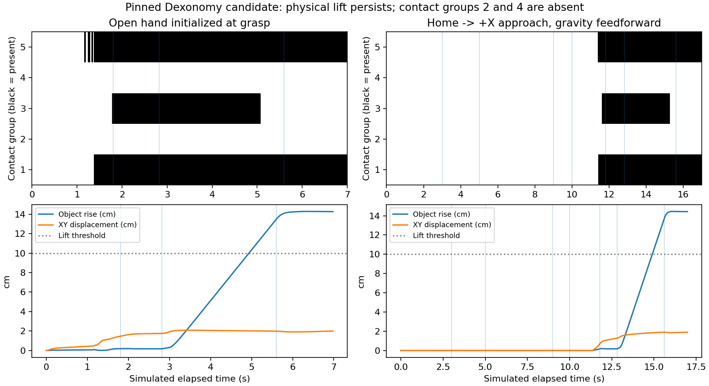
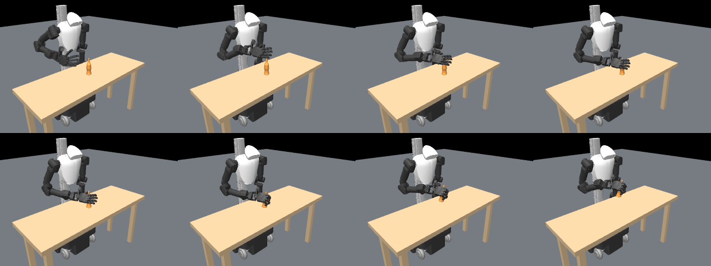

# Contact preservation and complete approach validation

The subsequent training-preparation pass fixes complete-state reset and
observation semantics. These archived runs retain their original source/physics
provenance; they are not automatically revalidated by current code. Fresh
home-path collection and quality gates are documented in
[the preparation guide](../../../configs/TRAINING_PREPARATION.md).

Same pinned Dexonomy bottle / 11_Power_Sphere / 0_14 candidate as the
[fixed student experiment](../fixed-student/README.md), scale 0.11 and yaw zero.
**A complete home-to-lift execution is now reproduced. Full teacher contact
preservation still fails.** These are selected, deterministic single-candidate
experiments, not population success rates or generalization evidence.

## What failed and what was corrected in the diagnostic executor

The historical collector assumes local hand +Z approach when the source has no
approach annotation. An endpoint open-hand fit does not validate that path.
A hand-only screen sampled all six signed local axes, at 5 mm intervals along
10 cm of retreat. Only +X had no hand-object or hand-table contact at every
sample. +Z had contacts at every sampled nonzero retreat. The original pose and
finger targets were retained; only the path into the pose changed.

The +Z initialized 2/5/10 cm trials begin in robot-object penetration (about
13–14 mm, including links outside the required groups; independently remeasured
from the archived v1 initial states in [initial_overlap.json](initial_overlap.json)). Their dynamic outcomes
are not valid free-space approach tests. Starting from the actual home state
avoids that reset issue, but the tested +Z overhead path pushes the object
about 140 mm and fails to lift it. A static endpoint check had missed the problem.
The sampled +X screen is not a continuous collision-free certificate; full-scene
physics is checked separately at every 2 ms integration step.

The new validation script explicitly selects the screened +X path. This result
has **not** been turned into a universal +X default in the old collector: other
candidates require their own direction and full-arm path validation.

## Contact preservation

Placing the measured hand exactly at the original squeeze configuration produces
all five annotated contact groups in a static forward pass. The original grasp
configuration, before squeeze, has roughly 1 mm positive gaps. Static placement
is not a physical execution or force-closure result; the large instantaneous
constraint forces after placing intersecting geometry are not sustainable forces.

During the baseline dynamic close, groups 2 (finger_r_link7/8) and 4
(finger_r_link15/16) never contact. At the end of settling, the hand root is
about 8.7 mm off target and the object has moved about 17.5 mm horizontally.
The two missing groups are approximately 14.9 and 9.7 mm from the object by
MuJoCo's geometry-distance query. During the final hold only two required groups
remain in contact. Geometry-distance queries are descriptive; actual contact
membership is determined from nonpositive contact distance, not a loose gap tolerance.

Stronger squeeze (1.5x/2x teacher squeeze travel), arm gravity feedforward, and a
40-tick delayed thumb closure did not restore five-group compliance. Following
the moving object with the original object-relative root pose drove it farther
away and eventually failed IK in the exploratory trial. These bounded failures
do not prove no contact-preserving executor exists. They do show that simply
increasing squeeze, changing approach, or compensating arm gravity is insufficient
for this candidate under the tested controls.

## Matched executed outcomes

| Configuration | Final rise | Maximum approach XY movement | Required groups, maximum | Sustained compliant lift |
|---|---:|---:|---:|---:|
| Initialized at open grasp | 14.26 cm | N/A | 3/5 | No |
| +X from 2 cm | 14.28 cm | 3.17 mm | 3/5 | No |
| +X from 5 cm | 14.29 cm | 3.17 mm | 3/5 | No |
| +X from 10 cm | 14.28 cm | 3.06 mm | 3/5 | No |
| Home → overhead → +X 10 cm → close/lift | 14.27 cm | 2.99 mm | 3/5 | No |
| Same home path + arm gravity feedforward | 14.43 cm | 0.021 mm | 3/5 | No |
| Same home path + gravity + delayed thumb | 14.21 cm | 0.021 mm | 3/5 | No |

All nine configurations in the final screened suite have a clear initialization
and a sustained physical lift, but zero have sustained five-group contact.
The other two configurations are initialized-at-grasp gravity feedforward and
delayed-thumb controls, available in [results.json](results.json). No measured
right-arm/hand-table penetration occurs in the final suite. This does not certify
all self-collision pairs, which remain subject to the model's collision filters.

The complete home episode lasts 850 control ticks (17 simulated seconds): 150
transit, 100 descend, 200 approach, 50 arrival, and 350 close/settle/lift/hold.
Root orientation stays at the teacher orientation after transit. Home transit
interpolates joint targets; descend/approach/lift use IK waypoints. The simulator
integration state is restored after planning, and motion uses physical actuators.
No arm or object pose is teleported after episode initialization. Gravity
feedforward offsets right-arm position commands by qfrc_bias / actuator gain;
physical gains, force limits, geometry, and teacher grasp remain unchanged.

## Measurement and reproducibility

Contact, force, and table penetration are inspected after every physics step.
A group is retained for a 50 Hz control tick only if present at all ten substeps.
Lift requires >10 cm for 25 consecutive ticks with at least one required contact
group and no table penetration beyond 2 mm. Teacher compliance requires all five
at every substep. Whole-episode acceptance additionally rejects initially
penetrating states, table penetration anywhere in the path, and approach XY
movement beyond 10 mm. Exact label/type and semantic-part preservation remain
separate, untested claims. Normal forces are logged separately from membership.

[approach_screen.json](approach_screen.json), [static.json](static.json),
[results.json](results.json), and [manifest.json](manifest.json) contain final
measurements. Full per-tick traces and integration-state/action replay bundles
are in out/contact-approach-v3. [exploratory_v1.json](exploratory_v1.json) retains
all eight initial trials, including failures and invalid retreat initializations;
its [matching source](exploratory_v1.py) and manifest are archived. v2 is a local
intermediate run whose final source hash raced with an edit and whose thumb-delay
option was not yet connected; it is excluded from reported comparisons. v3
reran the corrected screened suite with the final script and matching hash.
External mesh/robot assets remain local dependencies; this is not a portable
benchmark package. Code dependency hashes are recorded in dependencies.json.

Run from the repository root with fresh output directories:

~~~bash
OPENBLAS_NUM_THREADS=1 third_party/dexonomy/.venv/bin/python scripts/validate_teacher_execution.py \
  --suite screened --out out/my-contact-approach
OPENBLAS_NUM_THREADS=1 third_party/dexonomy/.venv/bin/python scripts/replay_teacher_execution.py \
  --run out/my-contact-approach --trial axis_x_home --repeats 2 --out out/my-home-replay
~~~

Use --suite all to include the explicitly labeled colliding +Z initializations,
squeeze multipliers, and following-object diagnostic. Those invalid resets are
failure diagnostics, not accepted demonstrations. Existing fixed-student code,
checkpoints, and teacher files were not modified. The previously trained student
has not been trained/evaluated on this newly validated full approach trajectory.

## Consequence for the next experiment

Full approach is no longer the blocker for this pinned candidate. Contact-aware
closure is: teacher squeeze targets plus physical lifting can discard two required
groups throughout the episode. Preserve candidate/part/contact labels, reject
noncompliant demonstrations as positive transfer examples, and evaluate a bounded
contact-feedback or constrained closure controller before scaling RL or collecting
more student data. Do not relax the contact criterion to turn these lifts into
claimed knowledge-transfer successes.

## Replays and checks

The unmodified stored +X home trajectory was replayed twice from its full
integration state. Both repeats reproduce the sustained lift (about 14.27 cm),
missing groups, and approximately 3 mm approach movement. Maximum height-trace
difference from the original execution is 3.5e-8 m. Original plus two repeats
is 3/3 physical lifts and 0/3 teacher-compliant lifts on the same selected state;
these are deterministic repeats, not independent tasks. See [replay.json](replay.json).

40 repository tests passed. New regression checks catch contact loss/table
collision between 50 Hz observations and prevent a later valid lift from erasing
an invalid initialization or failed approach. Scoped Ruff and diff checks passed.
The paper has static structural checks only because no LaTeX engine is installed.

Follow-up: [contact-feedback control](../contact-feedback/README.md) now reproduces
five-group lifts on this candidate. Those executions still have large transient
hand-object penetration and are not clean demonstration positives. The fixed-control
measurements above remain historical evidence for their stated protocol.
