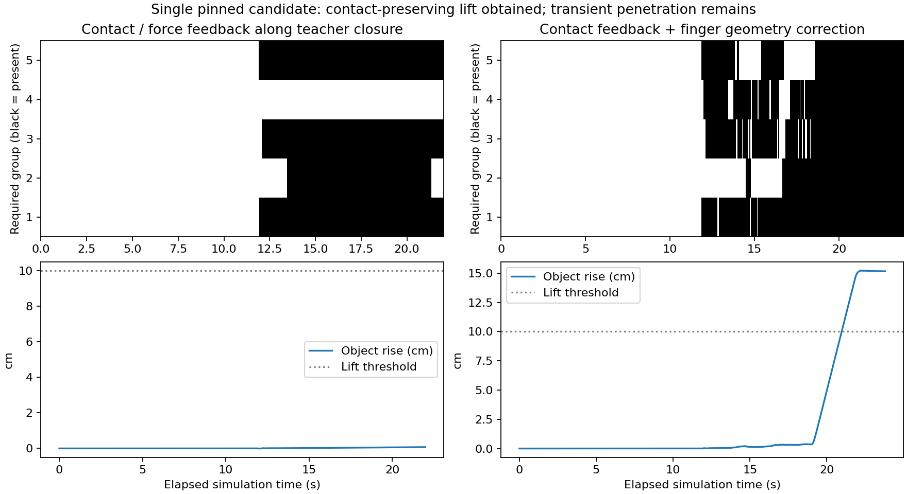
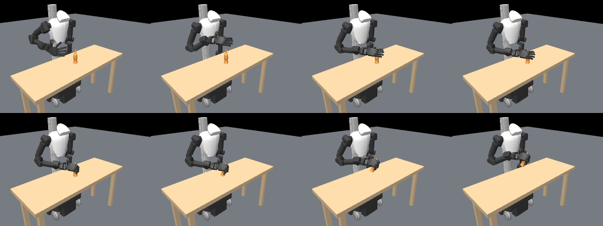

# Contact-feedback closure, 2026-09-08

**Subsequent audit:** the [physics comparison](../contact-physics/README.md)
retains the high penetration after fixing warmstart observation, and loses
five-group support when the saved commands are replayed at 1 ms. This report
describes its archived source snapshots. Reset/observation and controller code
have since changed; use the [new collection workflow](../../../configs/TRAINING_PREPARATION.md)
for fresh data and retain these historical trajectories as diagnostics.

**Contact-preserving lift is reproduced on the pinned candidate, but clean
contact physics under an explicit quality bound is not yet established.**
The same bottle, 11_Power_Sphere teacher candidate, scale 0.11, yaw zero, scene,
actuator gains/force limits, and verified +X home approach are retained. This is
an experimental privileged executor; the visual student is unchanged.

## Implemented control

ContactClosure adjusts five closure-progress variables along the teacher's
open-to-squeeze joint directions. Missing groups advance; touching groups relax
excess force or maintain a small preload. It limits joint-command increments and
closure extension. ContactGeometry adds small finger-only Jacobian corrections
when an annotated contact group remains absent. It finds the closest collision
surface on an allowed teacher contact body and moves that finger toward the
object. It does not move simulated qpos while planning and does not alter teacher
labels or simulator parameters. This geometric feedback uses privileged object
geometry and robot Jacobians, not just tactile sensing.

The selected controller uses 2 N preload and 8 N carrying targets. These are
regulation setpoints, not hard force limits. Finger commands change by at most
0.015 rad per 50 Hz step. The geometry offset is clipped to +/-0.35 rad per joint;
the admissible command interval includes the original open pose and the teacher
squeeze pose expanded by +/-0.35 rad. Thus the total deviation from squeeze can
exceed 0.35 rad on the open side. Final measured deviation reaches 0.491 rad in
the successful run. This adapts teacher finger posture to realize its annotated
contact groups; it is not exact joint-pose copying or proof of an exact grasp-type
label, contact-normal pattern, or semantic-part constraint.

All five groups must have contact and >0.1 N normal force at every physics
substep for 25 consecutive control ticks before lift starts. During lift, lost
contact pauses upward command progression while finger feedback continues. The
hand target rises 15 cm, then holds for 100 ticks. Contacts/forces are measured
at every 2 ms physics step, with conservative ten-substep aggregation per tick.
Force peaks also include finger links outside the annotated groups. The existing
teacher-compliant success criterion (>10 cm rise for 25 ticks, all five groups,
and no robot-table penetration beyond 2 mm) is retained. A separate positive-force
success criterion checks >0.1 N per group throughout the holding interval.

## Results

| Controller | Outcome | Maximum simultaneous groups | Relevant limitation |
|---|---|---:|---|
| Fixed teacher squeeze, contact-gated lift | Closure timeout | 3/5 | No lift permission |
| Scalar contact/force feedback | Closure timeout | 4/5 | Group 4 stays absent |
| Scalar feedback + geometric correction | 3/3 contact-preserving lifts | 5/5 | Transient hand-object penetration |
| Three gentler settings | 0/3 sustained lifts | 5/5 transiently | Contact lost or not sustained long enough |
| Geometric feedback + 2 mm / 30 N preview guard | Constraint stop before lift | 4/5 | No feasible command among tested local choices |

The three successful executions run the feedback controller anew from the same
saved full initial state and validated approach. They are identical-condition
repetitions, not independent tasks or generalization estimates. Final rise is
15.163 cm. Above 10 cm, all five contacts and positive group forces persist for
142 consecutive ticks (2.84 s). Minimum forces over that interval are approximately
[6.10, 6.56, 4.66, 7.58, 2.41] N. No measured right-arm/hand-table penetration occurs.
Approach XY displacement is about 0.025 mm. The selected controller lifts after
about 9 seconds of closure feedback; a one-time contact-count maximum is not
used as the lift trigger.

## Why this is not yet a clean demonstration source

The successful controller reaches about 60.7 N maximum summed normal force on
one digit and 7.49 mm maximum robot-object penetration during closing. Final
penetration is about 1.70 mm. The fixed-squeeze baseline reaches about 78.2 N
and 6.97 mm despite failing full contact preservation. These unchanged-model
comparisons do not justify accepting either as clean contact physics.

The gentler settings reduce geometric correction and carrying force, but all
three fail to complete a sustained lift; peak penetration remains 5.08–6.90 mm.
The preview guard directly tests each proposed command for ten physics steps,
restores the full integration state, and tries fractions 1, 0.5, 0.25, 0 of the
command update plus a small opening command. It rejects predicted robot-object
penetration >2 mm or any digit's summed normal force >30 N. These are explicitly
chosen diagnostic quality limits, **not hardware-certified safety limits**.
The guarded trial stops when none of these local commands satisfies them.
Executed motion stays below 1.978 mm and 24.09 N, but does not lift. This is a
bounded local-preview failure, not proof no constrained controller can succeed.
The guard is not a complete motion planner or a real-robot safety controller.

Consequently, the success flag in the unguarded results means the stated
contact/height criterion passed. It must not be read as a clean-demonstration
approval. Do not add these trajectories to a positive training set without
retaining the penetration/force qualification. No student training or hardware
execution was performed in this follow-up.

## Evidence and reproduction

- v1: scalar feedback / preload / speed / extension exploration; all five failed.
- v2: geometric feedback exploration; 2/3 passed the contact-lift criterion. Its
  force peaks were sampled at control endpoints, so use v3 for detailed forces.
- v3: fixed and scalar baselines plus three selected geometric feedback runs;
  every-substep force and penetration reporting. Main contact-preservation evidence.
- v4: three gentler settings; all failed, retained without selection filtering.
- v5: explicit penetration/force preview guard; constraint-stop failure retained.

Each vN_results.json and vN_manifest.json here has the raw summaries and source
configuration. Matching experiment/controller snapshots are archived alongside
them. Full per-tick traces, feedback records, commands, and complete initial states
remain under out/contact-feedback-vN. External robot/mesh assets remain dependencies;
this is not a portable benchmark. The successful geometry command trajectory was
also replayed for the figure; this is visualization, not an additional task trial.

Run from the repository root using fresh output directories:

~~~bash
OPENBLAS_NUM_THREADS=1 third_party/dexonomy/.venv/bin/python scripts/contact_feedback_experiment.py \
  --suite final --source out/contact-approach-v3 --out out/my-contact-feedback
OPENBLAS_NUM_THREADS=1 third_party/dexonomy/.venv/bin/python scripts/contact_feedback_experiment.py \
  --suite gentle --source out/contact-approach-v3 --out out/my-gentle-feedback
OPENBLAS_NUM_THREADS=1 third_party/dexonomy/.venv/bin/python scripts/contact_feedback_experiment.py \
  --suite guarded --source out/contact-approach-v3 --out out/my-guarded-feedback
~~~

To recreate the source approach bundles first, follow the
[approach validation commands](../contact-approach/README.md). Implementation:
[src/icra/contact_control.py](../../../src/icra/contact_control.py) and
[scripts/contact_feedback_experiment.py](../../../scripts/contact_feedback_experiment.py).

## Next technical question

Can constrained closure recover these five contacts while respecting a defensible
penetration/force budget? The present greedy finger correction and short preview
are insufficient under the tested 2 mm / 30 N limits. Investigate compliant contact
control, coordinated hand/root adjustments, or a longer constrained prediction
horizon under matched physics; separately validate the simulator's contact
parameters. The experiment supports continuing contact-aware execution research,
not scaling the current unguarded trajectories as clean teacher demonstrations.

Validation: 49 repository tests passed, including per-digit pressure release,
closure/rate bounds, geometry-query state preservation, and preview-state
restoration on both accepted and rejected commands. Scoped Ruff and diff checks
passed. All five archived experiment/controller snapshots match their recorded
hashes. Paper checks were static; no LaTeX engine was available.
