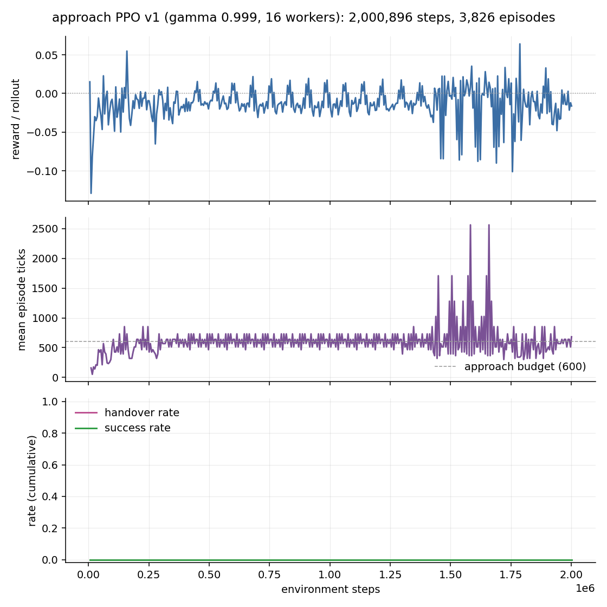

# 첫 접근 RL 학습 (ppo-v1): 200만 스텝, 인계 0회

고정 후보 `grasp_38_r120_d0` / `big1_offset_s0` / 정련 파일 sha `05b63bfb2990…`,
물체 `core_bottle_6444…` scale 0.11, yaw 0. gamma 0.999, worker 16, 접근 예산
600 tick, 실행기 예산 950 tick. 2,000,896 스텝 · 3,826 에피소드 · 약 42분
(788 steps/s). 보상 계수·충돌 제한·완주 판정은 이전과 같다.



## 결과: 인계 0회, 완주 0회

3,826 에피소드에서 인계 조건(5 mm · 0.05 rad · 물체 이동 5 mm · 무접촉 ·
5 tick 연속)을 만족한 적이 **한 번도 없다**. 따라서 실행기로 넘어간 적도,
완주한 적도 없다.

## 정지한 것은 아니지만, 접근 자세를 배운 것도 아니다

**정정.** 초판에서 "마지막 13 mm를 못 좁힌다"고 쓴 것은 틀렸다. 최근접 거리만
보고 쓴 진단이었고, tick 단위로 다시 보면 위치와 자세가 함께 맞아가는 상태가
아니다. 평균 행동 재평가([trace-mean.json](trace-mean.json)):

| 항목 | 값 |
| --- | ---: |
| 위치가 가장 가까워진 시점 | tick 31 / 600 |
| 그때 위치 오차 | 18.16 mm |
| 그때 자세 오차 | **130.25°** (게이트 허용 2.86°) |
| 그때 물체 이동 | 0.011 mm |
| 종료 시 위치 오차 | 269.4 mm |

즉 손목이 초반에 목표 위치를 **스쳐 지나갔을 뿐**이고, 파지에 필요한 방향은
크게 틀어져 있었다. 궤적 전체에서도 그렇다.

- 자세 오차의 최솟값은 **시작 시점의 105.9°**이고 이후로는 128–148°로 더
  나빠진다. 게이트(2.86°) 근처로 간 tick은 **0회**, 위치 5 mm 이내도 **0회**다.
- 마지막 100 tick은 264.9 ± 2.9 mm에 머문다.
- 정책의 원시 행동은 rate 제한을 크게 넘어(에피소드 평균 최대 |행동| 2.53,
  최대 4.49) **600 tick 중 590 tick에서 적어도 한 관절이 포화**한다.

정확한 서술은 "정밀 정렬의 마지막 단계"가 아니라 **"올바른 접근 자세와 경로를
아직 배우지 못했다"**이다.

두 가지는 그래도 사실이다. 에피소드 평균 길이가 258 → 약 600 tick으로 올라
초기의 이른 종료(충돌·침투)가 줄었고, 정지한 정책(303.6 mm)과 달리 손목이
크게 움직인다.

| 정책 | 최근접 | 그때 자세 오차 | 종료 |
| --- | ---: | ---: | --- |
| 학습된 정책(평균 행동) | 18.2 mm | 130.25° | `approach_timeout` |
| 학습된 정책(샘플, 10회) | 35.1 mm(중앙값) | — | `approach_timeout` ×10 |
| 영 행동 | 303.6 mm | 105.4°(변화 없음) | `approach_timeout` |
| 기록된 접근(참조) | 2.65 mm | 0.15° | 인계 → `completed` |

## 왜 거기서 멈추는가 — 보상으로 설명된다

potential 보상은 정의상 telescoping이므로, **종료로 끝나는 에피소드의 할인 누적
shaping 합은 경로와 무관하게 −Φ(s₀)** 하나로 결정된다. 실제 값으로 확인했다.

| 항목 | 값 |
| --- | ---: |
| Φ(s₀) (시작 자세의 potential) | −13.433 |
| shaping 합 = −Φ(s₀) (모든 경로 동일) | +13.433 |
| 시간 벌점 600 tick | −4.514 |
| 실패 보상 (tick 600) | −13.730 |
| **예측 수익** | **−4.811** |
| 측정: 영 행동 / 학습된 정책 | −4.811 / −4.811 |

**18.2 mm까지 접근한 정책의 할인 누적 보상이 제자리에 선 정책과 소수점 13자리까지
같다.** 성공은 25.738(= 13.433 + 15.937 − 3.632, 측정치와 일치)이므로 성공과
실패의 차이는 30.5로 충분하다. 문제는 **실패 집합 안에 기울기가 없다**는 것이다.
마지막 13 mm를 좁힐 이유는 인계 게이트를 넘는 순간의 +25뿐이고, 그전까지는
303 mm에 서 있는 것과 18 mm까지 간 것이 같은 값이다.

같은 이유로, 손목이 목표를 스쳐 지나간 뒤 269 mm로 멀어져도 벌점이 없다.

**여기까지가 확인된 사실이다.** 같은 초기 상태에서 같은 시각에 실패하고 밀림
벌점도 같으면 할인 누적 보상이 같다는 것, 그래서 시간 초과로 끝난 접근과 대기를
최종 수익으로 구별할 수 없다는 것.

**아직 입증하지 못한 설명**은 분리해서 적는다. 초판에서 "접근을 배운 원인은
충돌 회피뿐"이라거나 "게이트 통과 확률은 사실상 0"이라고 썼는데, 이번 실험은
그 인과나 확률을 측정하지 않았다. potential 보상은 중간 학습 신호를 제공하며,
그것이 성공 경험을 보장하지 않을 뿐이다. 실험으로 확인된 결론은 하나다:
**이 설정에서 성공 경험을 한 번도 얻지 못했다.**

## 이번 실행이 말하는 것과 말하지 않는 것

- 할인율 0.999 수정은 성공의 **가치**를 높이는 조정이었고 의도대로 작동한다
  (성공 25.7 대 실패 −4.8). 그러나 성공 경로를 **발견**하는 문제는 그대로 남는다.
- 이 실행은 "이 후보·이 초기 상태·이 정책 초기화에서 200만 스텝의 PPO가
  게이트를 찾지 못했다"는 것이다. 환경이나 보상이 틀렸다는 증거가 아니며,
  실제로 환경은 기록된 접근을 넣으면 그대로 완주시킨다.
- 정책이 학습한 것(충돌 회피·접근)은 보상 구조에서 예측 가능한 부분이고,
  학습하지 못한 것(정밀 정렬)도 마찬가지로 예측 가능하다.

## 다음에 시도할 것 (권장 순서)

1. **기록된 접근으로 초기화한다.** 성공한 접근 451 tick의 (관측, 행동) 쌍이
   이미 있고, 그 행동은 정책의 행동 공간 안에 있다(rate 제한의 최대 0.184).
   행동 복제로 정책을 초기화한 뒤 PPO로 미세조정하면 탐색 문제를 우회한다.
   교사 지식을 쓰는 이 프로젝트의 방향과도 일치한다.
2. **역커리큘럼.** 기록된 궤적 위의 여러 지점에서 에피소드를 시작해(끝에서부터
   점점 앞으로) 게이트까지의 거리를 줄인다. 게이트와 성공 판정은 그대로 둔다.
3. 위 둘이 모두 실패하면 게이트를 완화하거나 "게이트 근처 유지"에 보상을 준다.
   다만 이는 **도착 자체에 보상을 주는 것**이라 지금까지의 원칙과 어긋나므로
   마지막 수단으로 두고, 바꾸면 그 사실을 명시한다.
4. 성공 보상·충돌 벌점·보조 보상 계수는 이번에도 **동시에 바꾸지 않는다.**

## 기록과 재현

- [progress.tsv](progress.tsv), [curve.png](curve.png) — 학습 곡선
- [manifest.json](manifest.json) — 설정·코드 해시·`training_started`
  (`2026-09-09T00:22:40+0900`)
- [evaluation-mean.json](evaluation-mean.json),
  [evaluation-sampled.json](evaluation-sampled.json) — 학습 후 정책 평가
- 체크포인트: `out/rl-approach/ppo-v1/policy.pt`

```bash
# 학습 (tmux 세션 icra-ppo에서 실행함)
OPENBLAS_NUM_THREADS=1 MUJOCO_GL=egl third_party/dexonomy/.venv/bin/python \
  scripts/train_approach_rl.py --manifest out/rl-approach/candidate.json \
  --out out/rl-approach/ppo-v1 --workers 16 --steps 2000000 \
  --approach-steps 600 --seed 0 --device cuda:0
# 평가
OPENBLAS_NUM_THREADS=1 MUJOCO_GL=egl third_party/dexonomy/.venv/bin/python \
  scripts/evaluate_approach_policy.py --policy out/rl-approach/ppo-v1/policy.pt \
  --manifest out/rl-approach/candidate.json --episodes 3 \
  --out out/rl-approach/ppo-v1/evaluation-mean.json
# 그림
OPENBLAS_NUM_THREADS=1 MUJOCO_GL=egl third_party/dexonomy/.venv/bin/python \
  scripts/plot_approach_training.py --progress out/rl-approach/ppo-v1/progress.tsv \
  --out out/rl-approach/ppo-v1/curve.png
```

그림 가운데 패널에서 600을 넘는 값은 rollout 경계에서 에피소드 수를 세는
방식 때문에 생기는 추정 잡음이다. 실제 에피소드는 예산에서 끊긴다.

## 이어지는 실행

이 결과를 받아 행동 복제로 정책을 초기화했다:
[approach-bc-v1](../approach-bc-v1/README.md). 검증된 시범 9회(4,030 쌍)에서
복제한 정책은 home에서 시작해 평균 행동 3/3, 잡음 0.05에서 9/10 완주한다.
같은 환경·같은 보상·같은 게이트이므로, PPO 단독의 실패는 환경의 오류가 아니라
성공 경로를 발견하지 못한 문제였음이 확인된다.
